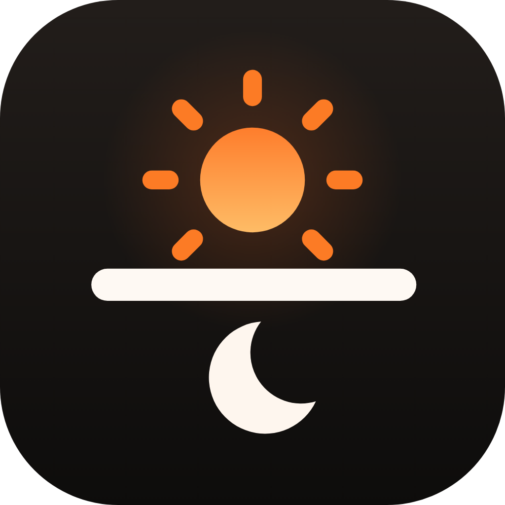
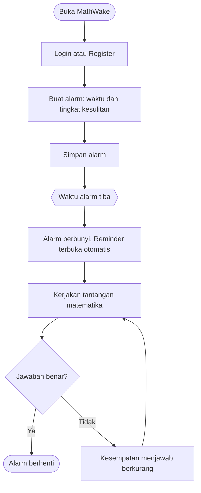
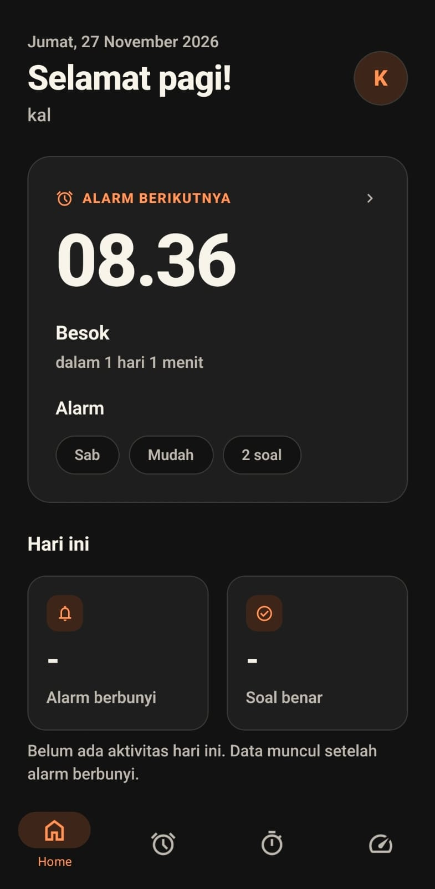
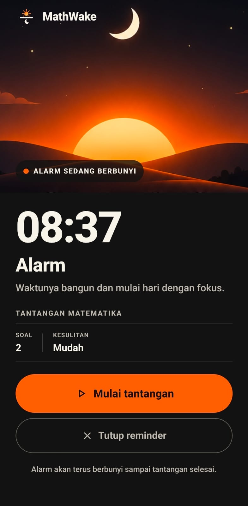
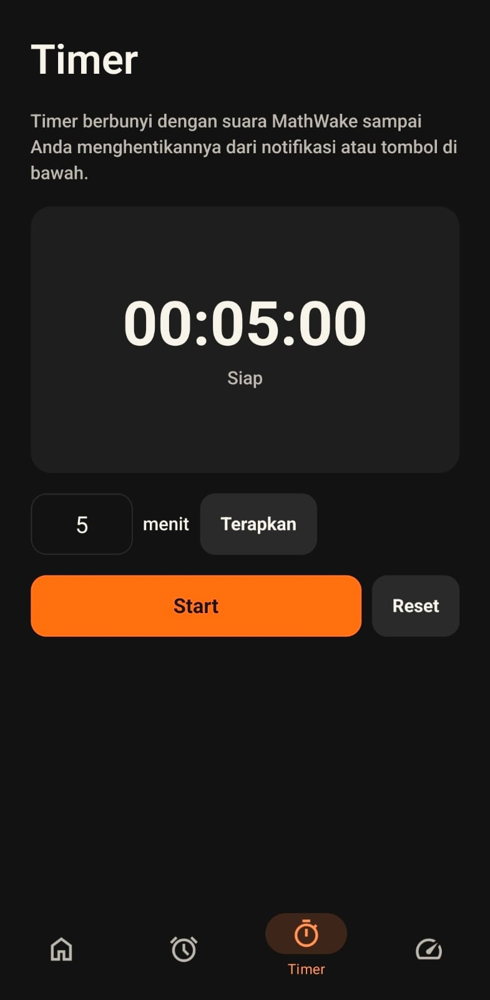
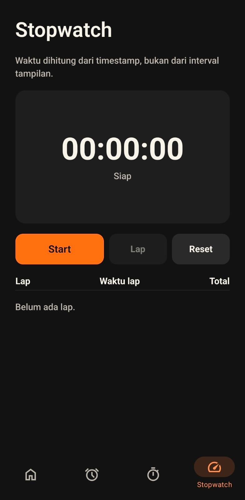

# MathWake

**Aplikasi alarm yang baru berhenti setelah penggunanya menyelesaikan tantangan matematika.**

 

**[Pasang Demo](https://expo.dev/accounts/nextherinn/projects/MathWake/builds/eba85465-81a0-4561-a815-14f9e6f5167a)**
&nbsp;·&nbsp;
**[Source Code](https://github.com/Muhamad-Haekal/MathWake)**

Karya untuk Traspac Competition 2027

---

**Daftar isi:**
[Tentang](#tentang) ·
[Cara kerja](#cara-kerja) ·
[Tampilan](#tampilan-aplikasi) ·
[Fitur](#fitur) ·
[Memasang dan mencoba demo](#memasang-dan-mencoba-demo) ·
[Teknologi](#teknologi) ·
[Status](#status-pengembangan) ·
[Istilah](#istilah) ·
[FAQ](#tanya-jawab)

---

## Tentang

Alarm biasa mudah dimatikan: satu sentuhan, lalu pengguna kembali tidur. MathWake mengubah hal itu. Alarm hanya berhenti setelah pengguna menyelesaikan tantangan matematika, sehingga pengguna benar-benar terjaga sebelum alarm diam.

Pengguna dapat memilih tiga tingkat kesulitan (Mudah, Sedang, Sulit) dari **1.250 soal**. Selain alarm, MathWake menyediakan Snooze, Timer, Stopwatch, dan Statistik aktivitas.

## Cara kerja

1. Pengguna membuka MathWake, lalu login atau membuat akun.
2. Pengguna membuat alarm, menentukan waktu, dan memilih tingkat kesulitan.
3. Saat waktunya tiba, alarm berbunyi dan layar Reminder terbuka secara otomatis.
4. Pengguna mengerjakan tantangan matematika.
5. Jika jawaban salah, kesempatan menjawab dibatasi.
6. Alarm berhenti setelah tantangan diselesaikan.

## Tampilan aplikasi

<table>
  <tr>
    <td align="center" width="33%">
       
      <b>Dashboard</b> Halaman utama aplikasi
    </td>
    <td align="center" width="33%">
       
      <b>Edit Alarm</b> Atur waktu alarm
    </td>
    <td align="center" width="33%">
       
      <b>Form Tantangan</b> Tantangan matematika
    </td>
  </tr>
  <tr>
    <td align="center" width="33%">
       
      <b>Reminder</b> Terbuka otomatis saat alarm berbunyi
    </td>
    <td align="center" width="33%">
       
      <b>Timer</b> Hitung mundur
    </td>
    <td align="center" width="33%">
       
      <b>Stopwatch</b> Pengukur durasi
    </td>
  </tr>
</table>

## Fitur

| Fitur | Keterangan |
|---|---|
| Login dan Register | Akun wajib; data alarm dan statistik tersimpan per pengguna |
| Alarm | Atur waktu alarm sesuai kebutuhan |
| Tantangan matematika | Tiga tingkat kesulitan: Mudah, Sedang, Sulit (1.250 soal) |
| Batas kesempatan menjawab | Jawaban salah dibatasi agar tidak dapat ditebak terus-menerus |
| Stop alarm | Hanya dapat dilakukan setelah tantangan diselesaikan |
| Snooze | Menunda alarm sementara |
| Reminder otomatis | Layar tantangan terbuka sendiri saat alarm berbunyi |
| Statistik | Ringkasan aktivitas berdasarkan data penggunaan nyata |
| Timer | Hitung mundur |
| Stopwatch | Pengukur durasi |

## Memasang dan mencoba demo

**Yang dibutuhkan:** HP Android dan koneksi internet. Tidak perlu akun khusus; buat akun sendiri di dalam aplikasi.

> Disarankan memakai Android. Alarm native dikembangkan dan diuji di Android, sedangkan iPhone belum diuji.

### Memasang

1. Buka [link demo MathWake](https://expo.dev/accounts/nextherinn/projects/MathWake/builds/eba85465-81a0-4561-a815-14f9e6f5167a) di HP Android.
2. Ikuti tombol pemasangan pada halaman tersebut untuk mengunduh dan memasang aplikasi.
3. Jika Android meminta izin memasang aplikasi dari luar Play Store, izinkan.
4. Buka MathWake. Jika aplikasi meminta izin, misalnya notifikasi, izinkan agar alarm dapat berbunyi tepat waktu.

### Mencoba

1. Buat akun melalui halaman Register, lalu masuk.
2. Buat alarm dengan waktu beberapa menit dari sekarang.
3. Pilih tingkat kesulitan matematika, lalu simpan alarm.
4. Tunggu alarm berbunyi dan amati apakah layar Reminder terbuka otomatis.
5. Kerjakan tantangan. Coba menjawab dengan benar maupun salah untuk melihat batas kesempatan.
6. Selesaikan tantangan untuk menghentikan alarm.
7. Coba juga Snooze, Timer, Stopwatch, dan Statistik.

## Teknologi

| Teknologi | Peran |
|---|---|
| React Native dan Expo | Pengembangan aplikasi mobile |
| TypeScript | Bahasa utama aplikasi |
| Kotlin | Integrasi alarm native di Android |
| Supabase | Backend untuk akun, login, dan penyimpanan data |

## Status pengembangan

| Status | Cakupan |
|---|---|
| Selesai | Login/Register, Alarm, Tantangan matematika, Batas kesempatan menjawab, Stop alarm, Snooze, Reminder otomatis, Statistik, Timer, Stopwatch |
| Sudah diuji | Android: alarm, Reminder otomatis, dan Statistik |
| Belum dilakukan | Pengujian di iPhone |

## Istilah

| Istilah | Arti |
|---|---|
| Expo | Alat untuk membuat dan menguji aplikasi mobile |
| Build | Hasil kemasan aplikasi yang siap dipasang di HP |
| Backend | Sisi server yang menyimpan akun dan data |
| Supabase | Layanan backend yang dipakai MathWake |
| Native | Kode yang berjalan langsung di sistem Android |
| Kotlin | Bahasa pemrograman untuk pengembangan Android |

## Tanya jawab

**Apakah perlu akun?**
Ya. Buat akun sendiri melalui halaman Register.

**Apakah bisa dipakai di iPhone?**
Belum diuji. Untuk saat ini gunakan Android.

**Bagaimana jika jawaban salah?**
Kesempatan menjawab dibatasi, sehingga jawaban tidak dapat ditebak terus-menerus.

## Pembuat dan lisensi

Dibuat oleh [Muhamad Haekal](https://github.com/Muhamad-Haekal).
Dilisensikan di bawah [MIT](LICENSE).
